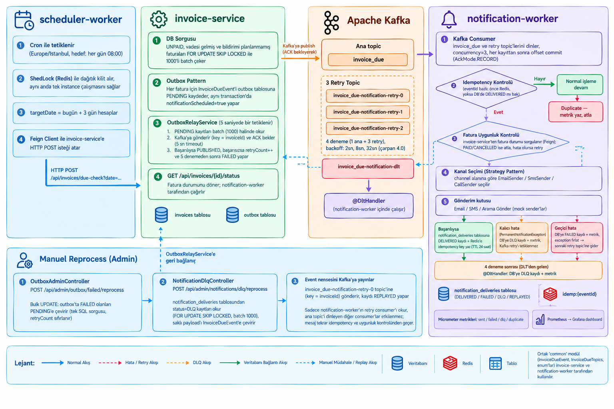

# Notification Service

An event-driven invoice-due notification system built with Java 21 and Spring Boot 3.4. It demonstrates the Transactional Outbox pattern, Kafka non-blocking retries with a dead letter topic, idempotent consumption, distributed scheduling with ShedLock, and metrics-based observability.

Two services work together:

| Service | Role | Port |
|---|---|---|
| `invoice-service` | Finds due invoices once a day, writes events to an outbox table, relays them to Kafka. | 8081 |
| `notification-worker` | Consumes events and sends notifications (mock senders) with retry, idempotency and DLQ handling. | 8083 |

Shared contracts (`InvoiceDueEvent`, `InvoiceDueTopics`, enums) and the Flyway migrations live in the `common` module. `invoice-service` and `notification-worker` share one PostgreSQL database.

> **Status:** this is a concept demo, not a production system. Nothing is actually sent: the senders are mocks, and `EmailSender` fails on purpose at random so that retries and the DLQ have something to show. See [Known limitations](#known-limitations).

## Architecture



### Concepts

- **Outbox:** the event is written to the database in the same transaction as the business change, then published to Kafka by a separate relay. This closes the "saved in DB but never reached Kafka" gap.
- **Retry:** transient failures are retried through Kafka retry topics with exponential backoff instead of blocking the main topic.
- **Idempotency:** a consumer has to claim an event before it sends anything. The claim is one atomic statement on a unique `event_id` index, so when the same event arrives twice, even at the same moment, only one copy is sent.
- **DLT vs DLQ:** *DLT* is the Kafka dead letter **topic** (`invoice-due-notification-dlt`). *DLQ* is a **status** in the `notification_deliveries` table for events whose retries are exhausted.
- **DLQ vs REJECTED:** a `DLQ` event failed for a reason that can pass (an outage), so replaying it later makes sense. A `REJECTED` event failed permanently: replaying it gives the same failure until someone fixes the cause. The two are kept apart so that a bulk replay never touches permanent failures.

## Services

### 1. invoice-service

Produces the events.

**Daily trigger** (`DailyInvoiceCheckScheduler`)
- Runs daily at 08:00 (`Europe/Istanbul`). The cron expression comes from `application.due-check.cron`.
- Takes a distributed lock with ShedLock on Redis (lock name `dailyInvoiceCheck`, `lockAtMostFor = 10m`, `lockAtLeastFor = 1m`), so only one `invoice-service` instance runs it.
- Runs the due check for `today + 3 days`.

**Due check** (the daily trigger, or `POST /api/invoices/due-check` by hand)
- Selects invoices with `status = UNPAID`, `due_date <= :date` (overdue invoices included) and `notification_scheduled = false`, using `FOR UPDATE SKIP LOCKED` in batches of 1000. Concurrent instances skip locked rows instead of waiting.
- Per batch, in **one transaction**: inserts one `InvoiceDueEvent` per invoice into the `outbox` table as `PENDING` and sets `notification_scheduled = true`. Batches repeat until nothing is left.
- Events are never sent to Kafka directly.

**OutboxRelayService**
- Runs every 5 seconds. In **one transaction** it reads up to 100 `PENDING` rows with `FOR UPDATE SKIP LOCKED` and publishes each to Kafka with `key = invoiceId`, waiting for the broker ACK (5 s timeout).
- Success: the row becomes `PUBLISHED`.
- Failure: the run stops at that row. The producer gives up on the send after 5 s as well (`delivery.timeout.ms`), so it is not delivered behind the relay's back later. It and the rows after it stay `PENDING` and are tried again on the next run, so an event is never given up on while Kafka is down.
- The row locks are held until the run commits, so a second relay instance skips these rows instead of publishing them again.

**Other endpoint**

| Endpoint | Purpose |
|---|---|
| `GET /api/invoices/{id}/status` | Current invoice status, or 404 for an unknown invoice. Called by `notification-worker` before sending. |

**Event contract**

```java
public record InvoiceDueEvent(
    UUID eventId, UUID invoiceId, String userId, LocalDate dueDate) {}
```

The event only says that an invoice is due. How the user is notified is decided by `notification-worker`.

### 2. notification-worker

Consumes `invoice-due` and its retry topics (`@RetryableTopic` + `@KafkaListener`, container concurrency 3, offset commit after every record).

For each event, `process()` runs these steps in order:

1. **Channel:** `NotificationChannelService.resolveChannel` picks the channel. Every event currently gets `application.notification.default-channel` (`EMAIL`).
2. **Redis fast path:** if `idemp:{eventId}` exists in Redis the event is already finished. It is counted in `notifications.duplicate` and dropped. Redis is only a cache here; if it is down this step is skipped.
3. **Claim:** one `INSERT ... ON CONFLICT (event_id) DO UPDATE ... WHERE` statement puts the row into `PROCESSING`. It succeeds for a new event, for one waiting for a retry (`FAILED`), for a replayed one (`REPLAYED`), and for a `PROCESSING` row older than 30 s (its consumer died). If it does not succeed:
   - the row is finished (`DELIVERED`, `SKIPPED`, `REJECTED`, `DLQ`): duplicate, dropped;
   - another consumer holds a fresh claim: this copy is sent to the retry chain and looks again later.
4. **Eligibility check:** calls `GET /api/invoices/{id}/status` on `invoice-service` via Feign. For a `PAID` or `CANCELLED` invoice the row becomes `SKIPPED` and nothing is sent.
5. **Send (Strategy pattern):** `EmailSender`, `SmsSender` or `CallSender`, chosen by `supports(channel)`. All senders are mocks.
6. **Record:** on success the row becomes `DELIVERED`, the Redis key is set with a 24 h TTL, and `notifications.sent` is incremented. These side effects run in a guarded block, so a failure in them is logged but never triggers a retry.

**Failure handling**

| Situation | Result |
|---|---|
| Duplicate event | Metric `notifications.duplicate`, dropped. No retry. |
| Same event being processed elsewhere | Goes to the retry chain without touching the row. |
| Invoice is `PAID` / `CANCELLED` | `SKIPPED` row + `notifications.skipped`; idempotency key is written. |
| Invoice does not exist (status call returns 404) | `REJECTED` row + `notifications.rejected`. No retry. |
| Invoice status call fails | `FAILED` row + `notifications.failed`, goes to the retry chain. |
| Unsupported channel | `REJECTED` row + `notifications.rejected`. No retry. |
| `PermanentNotificationException` | `REJECTED` row + `notifications.rejected`. No Kafka retry, unless the row cannot be written: then the message goes to the retry chain so the event is not lost. |
| Transient or unexpected exception | `FAILED` row + `notifications.failed`, exception thrown, message goes to the next retry topic. |
| All 4 attempts fail | `@DltHandler` writes a `DLQ` row + `notifications.dlq`; the message stays in the DLT. |

**Retry policy:** 4 attempts in total (1 main + 3 retry topics), exponential backoff of 2 s, 8 s and 32 s (multiplier 4.0).

**Delivery statuses** (`notification_deliveries.status`)

| Status | Meaning | Can be claimed again? |
|---|---|---|
| `PROCESSING` | A consumer holds the claim and is working on the event. | Only after 30 s |
| `DELIVERED` | Sent. | No |
| `SKIPPED` | Not sent because the invoice was already paid or cancelled. | No |
| `FAILED` | Transient failure, still in the retry chain. | Yes |
| `DLQ` | Retries exhausted. | After a replay |
| `REJECTED` | Permanent failure. | After a single replay |
| `REPLAYED` | Sent back for another try. | Yes |

A `DELIVERED` row is never overwritten by a later outcome.

## Kafka topics

| Topic | Purpose |
|---|---|
| `invoice-due` | Main event stream |
| `invoice-due-notification-retry-0` / `-1` / `-2` | Retry topics for the `notification-worker` consumer group |
| `invoice-due-notification-dlt` | Dead letter topic after all attempts fail |

Names and suffixes are defined once in `InvoiceDueTopics` (`common` module). `invoice-service` creates `invoice-due` and `notification-worker` creates the retry topics and the DLT, all from `application.kafka.topic.partitions` (default 3) and `application.kafka.topic.replication-factor` (default 1). Consumer concurrency comes from `spring.kafka.listener.concurrency` (default 3).

## DLQ reprocess

Nothing is retried forever. Failed work is parked and an admin decides when to replay it.

**Bulk replay:** `POST /api/admin/notifications/dlq/reprocess`

1. Reads `notification_deliveries` rows with `status = DLQ` (`FOR UPDATE SKIP LOCKED`, batches of 1000). `REJECTED` rows are not selected.
2. Converts each stored `eventPayload` back to an `InvoiceDueEvent`.
3. Publishes the event with `key = invoiceId` to **`invoice-due-notification-retry-0`** and waits for the ACK (5 s).
4. Marks the row `REPLAYED`.

This is the "the outage is over, try them again" action.

**Single replay:** `POST /api/admin/notifications/{eventId}/reprocess`

Replays one `DLQ` or `REJECTED` row the same way. It is meant for a `REJECTED` event after its cause was fixed. Returns 404 for an unknown event and 409 for a row in any other status. A `REJECTED` event whose cause was not fixed fails again and goes back to `REJECTED`.

Why `retry-0` and not the main topic? Only this consumer group reads the retry topics, so other consumers of `invoice-due` are not triggered again. The replayed event goes through the idempotency and eligibility checks from the start.

## Observability

- **Micrometer counters** (all tagged with `channel`):
    - `notifications.sent`: successful deliveries
    - `notifications.failed`: transient failures
    - `notifications.dlq`: events written as `DLQ` after their retries were exhausted
    - `notifications.rejected`: events written as `REJECTED`: permanent errors and unsupported channels
    - `notifications.skipped`: events not sent because the invoice was already paid or cancelled
    - `notifications.duplicate`: duplicates stopped by idempotency
- **Prometheus** scrapes `/actuator/prometheus` on `invoice-service` and `notification-worker` every 5 s.
- **Grafana** (`http://localhost:3000`) shows `rate()` panels for sent, failed and DLQ counters plus totals. `rate()` values are per second.
- **Kafka UI** shows the message count per topic, which makes the retry funnel visible.

## Failure injection

`EmailSender.injectChaos` makes the failure paths visible:

- About 5% of events fail **permanently**. This is tied to the `eventId`, not random, so the same event fails on every attempt, including a replay. These become `REJECTED`.
- Every other attempt fails **transiently** with a 15% chance and goes to the retry chain.

In a run of 1000 seeded events this gave 941 `DELIVERED` and 59 `REJECTED`, with 163 transient failures absorbed by the retry topics and no event reaching `DLQ` (four transient failures in a row are rare).

To see `DLQ` and the bulk replay, stop `invoice-service` after the events are published. The eligibility check then fails for every event, all four attempts are used up, and the events land in `DLQ`. Start `invoice-service` again and call the bulk replay. In a run with 200 events, all 200 reached `DLQ`; after the replay 184 were `DELIVERED`, 13 `REJECTED` and 3 back in `DLQ`.

## Quick start

### Prerequisites
- Java 21+
- Maven 3.8+
- Docker and Docker Compose

### Run

```bash
# Infrastructure (PostgreSQL, Redis, Kafka, Prometheus, Grafana, Kafka UI)
docker-compose up -d
sleep 30

# Build and run all services
./mvnw clean install
./mvnw -pl invoice-service spring-boot:run &
./mvnw -pl notification-worker spring-boot:run &

# Demo data: 1000 UNPAID invoices due in 3 days (run once the services have created the schema)
docker exec -i notification-postgres psql -U postgres -d notification_db < seed.sql
```

### Try it

```bash
# Trigger the due check manually (without a date it uses today + 3 days, which matches seed.sql)
curl -X POST http://localhost:8081/api/invoices/due-check

# Check an invoice status
curl http://localhost:8081/api/invoices/<invoice-id>/status

# Replay all DLQ rows into retry-0
curl -X POST http://localhost:8083/api/admin/notifications/dlq/reprocess

# Replay one DLQ or REJECTED event
curl -X POST http://localhost:8083/api/admin/notifications/<event-id>/reprocess
```

Health and metrics: `/actuator/health` and `/actuator/prometheus` on `http://localhost:8081` (`invoice-service`) and `http://localhost:8083` (`notification-worker`).

## Tech stack

| Component | Purpose |
|---|---|
| Java 21, Spring Boot 3.4 | Language and framework |
| Spring Data JPA, PostgreSQL 16 | Persistence (`invoices`, `outbox`, `notification_deliveries`) |
| Spring Kafka, Kafka 3.7 (KRaft) | Events, `@RetryableTopic`, DLT |
| Redis 7 | ShedLock locks and idempotency keys |
| ShedLock (Redis provider) | Distributed scheduling lock |
| Spring Cloud OpenFeign | Service-to-service HTTP calls |
| Micrometer, Prometheus, Grafana | Metrics and dashboards |
| Kafka UI | Topic inspection |
| Lombok, Maven | Build and boilerplate |

## Known limitations

This project shows the concepts and stops there.

- **Nothing is sent:** the senders are mocks, events carry only `userId`, and the channel is always `EMAIL`. `SmsSender` and `CallSender` exist to show the strategy pattern.
- **Failures are injected:** `EmailSender.injectChaos` is hard-coded and always on. Nothing can "fix" a permanently failing event, so a `REJECTED` event stays `REJECTED` however often it is replayed.
- **At-least-once delivery:** the outbox relay and Kafka can deliver an event more than once. If the relay crashes in the middle of a run, the whole batch is published again. The claim stops these copies from being sent twice. One gap remains: if the worker dies after a successful send but before it writes `DELIVERED`, the row stays `PROCESSING`, the claim goes stale after 30 s, and the redelivered event is sent again.
- **Stuck `PROCESSING` rows:** if writing `DELIVERED` fails after a successful send, the error is only logged (retrying would send the notification again) and the row stays `PROCESSING`. Nothing cleans these up.
- **No replay limit:** replay has no counter, so an event can be replayed and fail again any number of times.
- **No authentication** on any endpoint.
- **No outbox cleanup:** `PUBLISHED` rows are never deleted.
- **Local Kafka setup:** one broker, replication factor 1.

## License

MIT